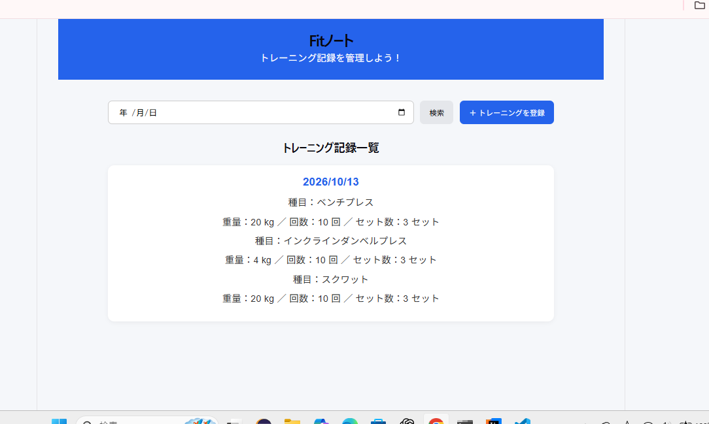
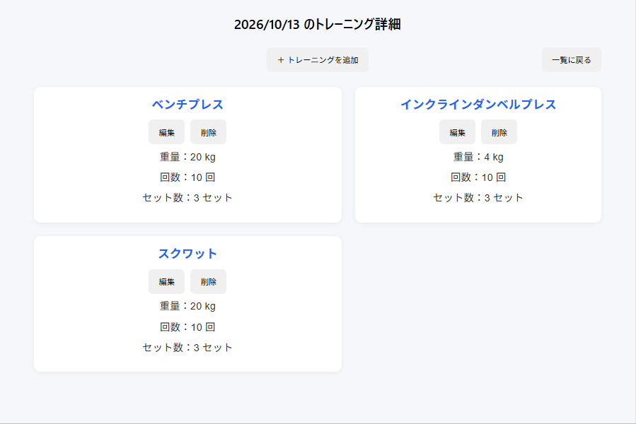
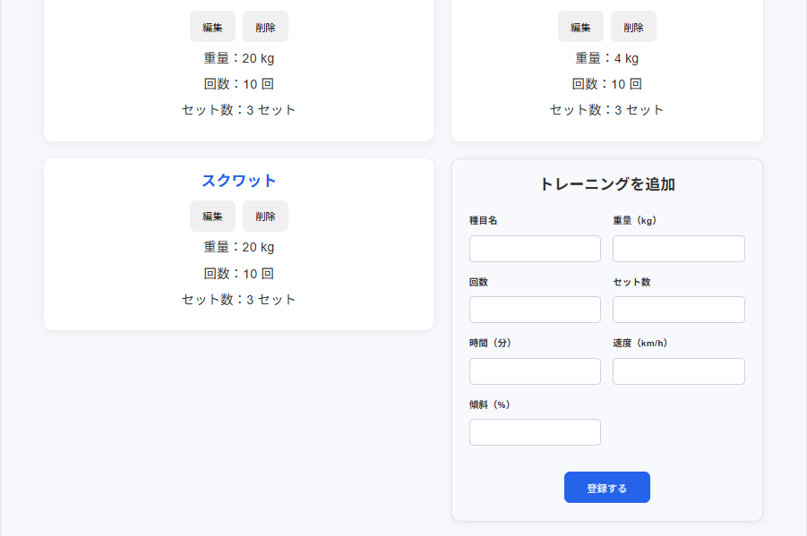
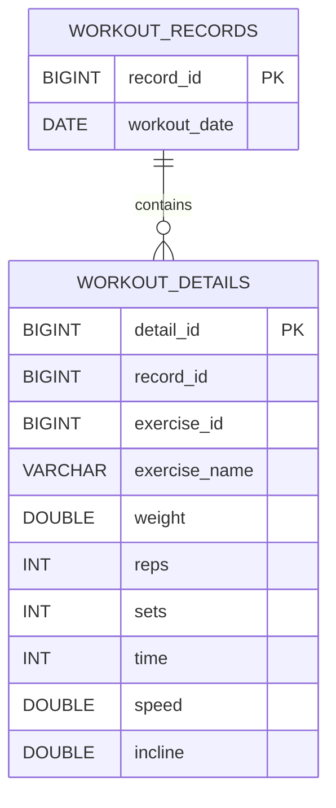
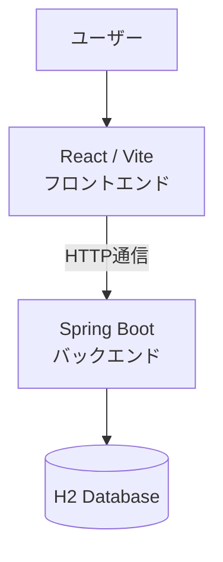

# Fitノート

## GitHubリポジトリ

[Fitノートのソースコードはこちら](https://github.com/ToyoshimaYuna/FitNote)

## アプリケーションの概要

Fitノートは、日々のトレーニング記録を管理するWebアプリケーションです。

トレーニングの日付や種目、重量、回数、セット数に加え、時間・速度・傾斜などを記録できます。
記録の一覧表示や編集、削除にも対応しており、日々のトレーニングを振り返ることができます。
### アプリ画面

#### トレーニング記録一覧



#### トレーニング詳細




#### トレーニング追加




## 開発した背景

普段から筋力トレーニングを行う中で、過去のトレーニング内容を確認する際に不便さを感じたことが、本アプリケーションを開発したきっかけです。

日々のトレーニングを記録していても、日付だけで表示されていると、過去にどのようなトレーニングを行ったのかを一目で把握することが難しく、確認するのに手間がかかっていました。特に、前回のトレーニングで行った種目や重量などを確認したいときに、スムーズに振り返ることができない点に課題を感じていました。

そこで、過去のトレーニング記録を一覧で確認できるようにし、必要な記録をすぐに見つけられるアプリケーションを作成したいと考えました。

本アプリケーションでは、最初の画面に過去のトレーニング記録を一覧表示することで、日々のトレーニング内容を簡単に振り返られるようにしています。また、記録した内容を編集・削除できるようにすることで、トレーニング記録を継続的に管理できるようにしました。

これにより、過去のトレーニング内容を確認する手間を減らし、記録の振り返りから次のトレーニングまでを、よりスムーズに行えるようにすることを目指しました。


## 主な機能

- **トレーニング記録の一覧表示**
  - 過去のトレーニング記録を一覧で確認できます。
- **トレーニング記録の登録**
  - 日付や種目、重量、回数、セット数などを登録できます。
- **トレーニング記録の詳細表示**
  - 登録したトレーニングの詳細な内容を確認できます。
- **トレーニング記録の編集**
  - 登録済みのトレーニング記録を変更できます。
- **トレーニング記録の削除**
  - 不要になったトレーニング記録を削除できます。
- **トレーニング種目の追加**
  - 新しいトレーニング種目を追加できます。

## 使用技術

### フロントエンド
- React
- Vite
- JavaScript

### バックエンド
- Java
- Spring Boot

### データベース
- H2 Database

## ER図（データベース設計）


## インフラ構成図



## 起動方法

### 前提条件
- Node.js がインストールされていること
- Java がインストールされていること

### 1. リポジトリをクローンする

```bash
git clone https://github.com/ToyoshimaYuna/FitNote.git
cd FitNote
```

### 2. バックエンドを起動する

`backend` フォルダに移動し、以下のコマンドを実行します。

```powershell
cd backend
.\mvnw.cmd spring-boot:run
```

バックエンドは `http://localhost:8080` で起動します。

### 3. フロントエンドを起動する

別のターミナルを開き、リポジトリのルートフォルダに移動して、以下のコマンドを実行します。

```bash
npm install
npm run dev
```

フロントエンドは、ターミナルに表示されるURL（通常は `http://localhost:5173`）にアクセスして利用します。